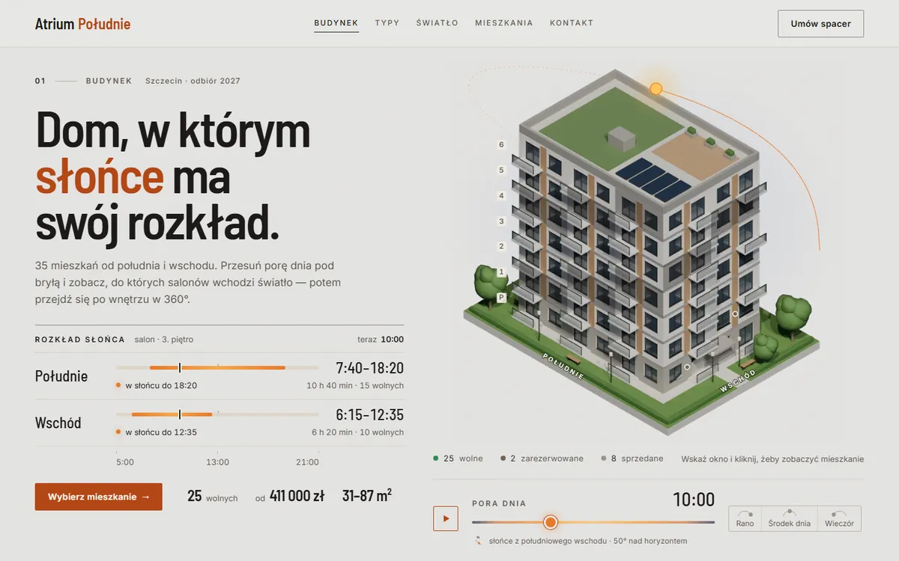
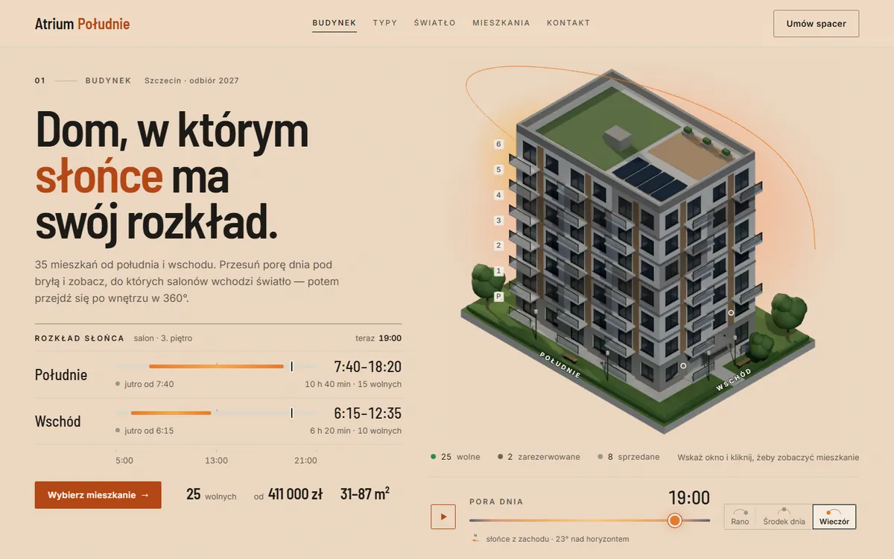
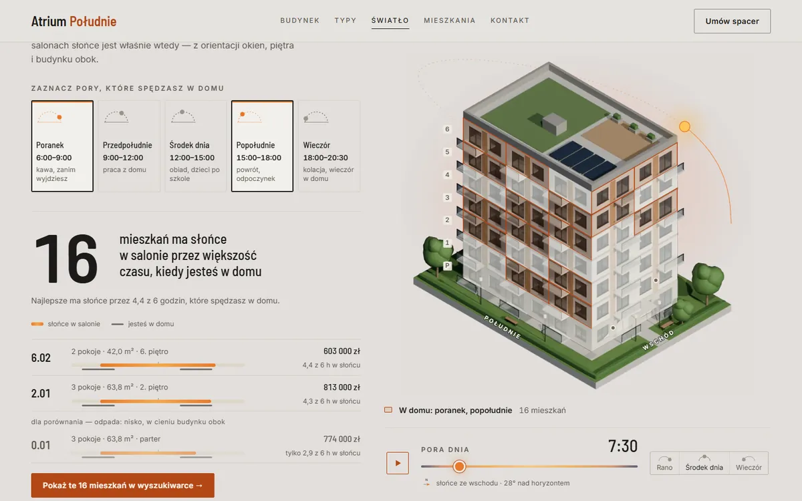
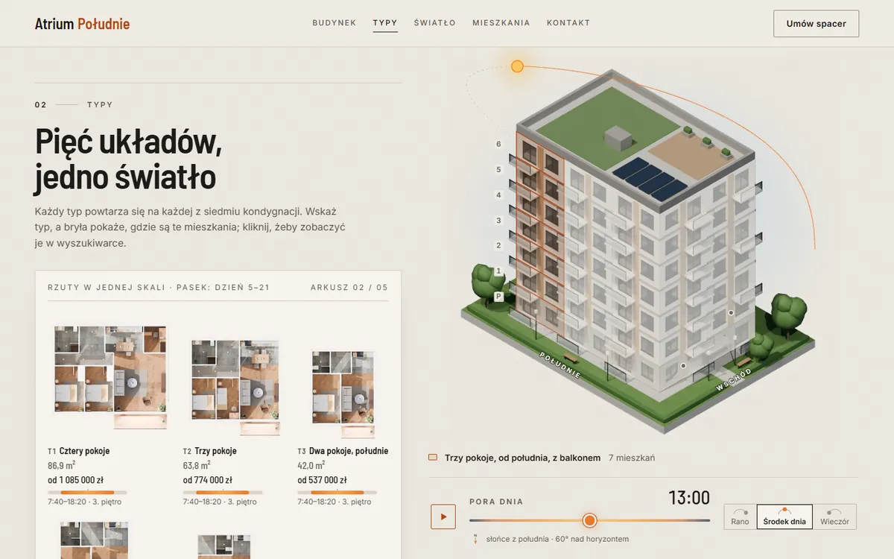
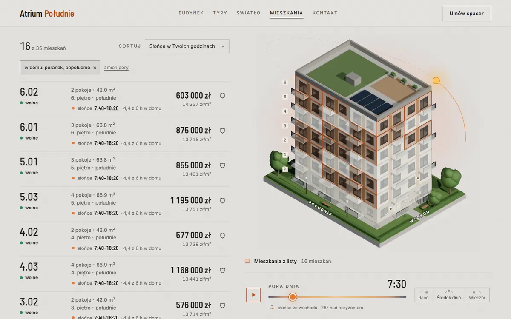
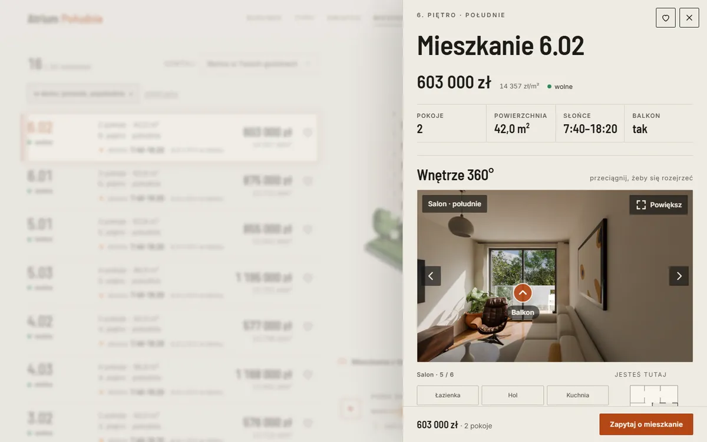
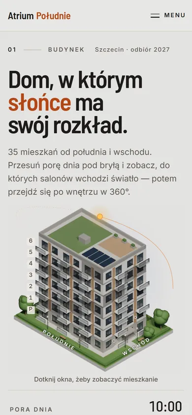
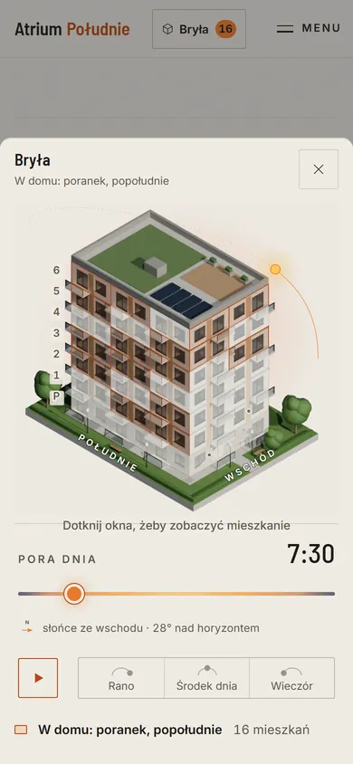
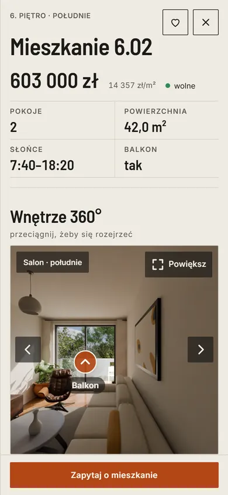

# Atrium Południe

**Wyszukiwarka mieszkań, w której wybiera się mieszkanie po słońcu.** Klient przesuwa porę dnia,
patrzy, do których salonów wpada światło, zaznacza, kiedy bywa w domu, i dostaje listę mieszkań,
które mają słońce właśnie wtedy. Potem wybiera okno na bryle budynku i ogląda wnętrze w 360°.

Inwestycja jest fikcyjna (Szczecin, 35 mieszkań, 7 kondygnacji). Budynek, wnętrza i panoramy
wyrenderowałem w Blenderze ze skryptów, z tych samych danych, z których korzysta strona.



## Po co to jest

Typowa strona dewelopera pokazuje tabelę mieszkań i rzuty. Kupujący pyta jednak o rzeczy,
których tabela nie mówi: *czy rano będzie jasno w salonie? czy po pracy jeszcze złapię słońce?*
Atrium odpowiada na te pytania na stronie, zanim klient przyjedzie na budowę:

- **Pora dnia steruje całą stroną.** Suwak zmienia render budynku, łuk słońca, rozkład godzin
  w hero i odcień strony (chłodny rano, ciepły wieczorem).
- **„Kiedy jesteś w domu?”** Klient zaznacza pory dnia, a strona liczy, ile z tych godzin każde
  mieszkanie ma słońce w salonie, i sortuje według tego listę.
- **Wybór na bryle.** Każde okno na renderze jest przyciskiem. Mieszkania pasujące do filtrów
  podświetlają się na budynku.
- **Panel mieszkania**: wnętrze 360° z przejściami między pokojami, rzut z wymiarami, wykres
  słońca w salonie przez cały dzień, kalkulator raty i zapytanie z godzinami spaceru, które
  klient sam wskazał.

| Pora dnia zmienia render i odcień strony | Mieszkania ze słońcem w Twoich godzinach |
|---|---|
|  |  |
| **Pięć typów w jednej skali** | **Lista mieszkań** |
|  |  |



### Na telefonie

Układ na telefonie jest zaprojektowany osobno. Bryła wysuwa się z dołu ekranu na żądanie, panel
mieszkania zajmuje cały ekran, a wszystkie cele dotyku mają co najmniej 44 px.

| Start | Bryła | Mieszkanie |
|---|---|---|
|  |  |  |

## Co jest w środku

**Front:** React 19, TypeScript, Vite. Bez bibliotek UI i bez frameworka CSS: własny system
tokenów (kolory, kroje, odstępy) i CSS z container queries. Bez backendu: dane powstają w kodzie,
formularz niczego nie wysyła.

**Model słońca** (`src/domain/sun.ts`): uproszczony długi letni dzień na ok. 53°N. Liczy
bezpośrednie słońce w oknach salonu dla każdej elewacji i piętra, z uwzględnieniem sąsiedniego
budynku, który zasłania niskim piętrom popołudnie. Z tego samego modelu biorą się godziny na
liście, wykres w panelu, filtr „w domu” i odcień strony.

**Bryła budynku:** 12 renderów (Blender Cycles) na różne godziny. Przenikają się płynnie przy
przesuwaniu suwaka, a niewidoczna warstwa SVG nad renderem zamienia każde z 35 mieszkań
w przycisk dostępny z klawiatury (strzałki poruszają się po siatce okien).

**Spacer 360°:** panoramy każdego pomieszczenia wyświetlane jednym shaderem WebGL, z punktami
przejść przy drzwiach, mini-mapą i obsługą klawiaturą. Ostrzejsza wersja panoramy dociąga się
dopiero, gdy jest potrzebna.

**Grafika ze skryptów:** budynek, wnętrza, okładki i makiety 3D rzutów generują skrypty Pythona
w Blenderze, z tych samych rzutów co strona. Test pilnuje, żeby miejsca kamer i przejścia między
pokojami w panoramach zgadzały się z planem mieszkań. Meble, rośliny i tekstury pochodzą
z Poly Haven (CC0).

**Dostępność:** pełna obsługa klawiaturą, fokus wraca tam, skąd otwarto panel, komunikaty dla
czytników ekranu przy zmianie wyników, `prefers-reduced-motion` w każdej animacji. Tekst w `rem`,
więc strona reaguje na powiększenie czcionki w przeglądarce i przy 200% przechodzi w układ
jednokolumnowy.

**Testy:** 563 testy w Vitest dla czystej logiki: dane mieszkań, model słońca, filtry
i sortowanie, kredyt, przejścia w spacerze, punkty kamer, nawigacja po siatce okien,
formatowanie liczb po polsku.

## Uruchomienie

```bash
npm install
npm run dev        # podgląd z odświeżaniem
npm test           # testy
npm run build      # sprawdzenie typów + build do dist/
```

Build używa ścieżek względnych (`base: './'`), więc zawartość `dist/` działa pod dowolnym
adresem, także w podkatalogu innej strony. Przy wdrożeniu pod docelowym adresem trzeba podać
pełny adres w `og:image` w `index.html` (serwisy społecznościowe nie przyjmują adresów
względnych).

## Struktura

```
src/
  domain/      czysta logika bez Reacta: dane, słońce, filtry, kredyt, spacer, formatowanie (+ testy)
  state/       wspólny stan; pora dnia ma osobny kontekst, bo zmienia się co klatkę
  components/  widoki, każdy z własnym plikiem CSS
  styles/      tokens.css (kolory, kroje, odstępy) i app.css (układ strony)
blender/       skrypty renderów i przygotowania obrazów na stronę
public/        rendery budynku, panoramy, okładki, fonty
```

### Grafika z Blendera

Każdy obraz na stronie da się odtworzyć ze skryptów, w tle (`blender --background --python ...`):

```bash
node blender/pobierz-zasoby.mjs    # tekstury, modele i HDRI z Poly Haven (CC0) do blender/assets/
node blender/eksport.mjs           # rzuty, przejścia i punkty kamer -> blender/plany.json
blender --background --python blender/budynek.py -- blender/render/budynek <godzina> 128 2
blender --background --python blender/wnetrze.py -- blender/plany.json <s0..s4n> blender/render/pano3 - 2560 96
blender --background --python blender/wnetrze.py -- blender/plany.json <id> blender/render/gora3 - 1536 96 gora
node blender/budynek-web.mjs       # rendery budynku -> public/budynek/*.webp
node blender/pano-web.mjs          # panoramy -> public/pano/<id>/<pokój>.webp
node blender/okladki.mjs           # okładki panelu i makiety 3D -> public/okladki, public/rzut3d
```

Skrypt wnętrz sam usuwa meble, które stanęłyby w drzwiach albo w miejscu kamery.

---

Projekt i wykonanie: **Mikołaj Sitek**, [SWN Development](https://swndevelopment.pl) ·
[hello@swndevelopment.pl](mailto:hello@swndevelopment.pl)
